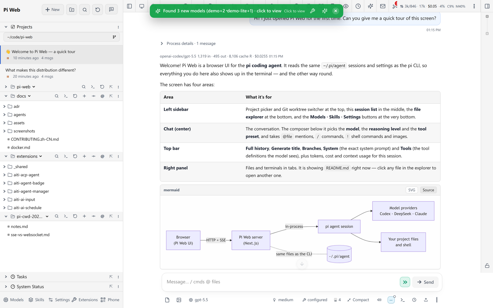

# aiti-demos

> Static showcase of **AITI Web** — the real workbench UI and the real extension host, backed by a recorded mock model. No server, no model calls, no install. **Live: <https://demo.aiti.pw/>**

English · [简体中文](./README.zh-CN.md)

Site <https://aiti.pw> · Demo <https://demo.aiti.pw> · Source <https://github.com/aiti-ai/aiti-ai>



## About aiti

This project is part of the **aiti** ecosystem — a personal AI development workbench powered by [pi](https://pi.dev): **aiti-agent** (a self-hosted web workbench built on the open-source [pi-web](https://github.com/aiti-ai/aiti-ai)) plus debug injection into mainstream dev tools (aiti-devtools) and a rich extension system.

- Workbench & monorepo: <https://github.com/aiti-ai/aiti-ai>
- Site: <https://aiti.pw>
- This demo: <https://demo.aiti.pw>

What you can click in the demo:

- **Sessions** — 15 tutorial conversations (English / 简体中文) covering the interface, files and `@` mentions, models, branching, queues, worktrees, multi-agent backends, secrets and page debugging.
- **Extensions** — the real full tier: 67 extensions in the catalog, 56 real client bundles loaded by the real extension host (app center, docks, settings takeovers, toolbars).
- **Files** — a real file tree with Monaco editing, `⇋ HEAD` diffs, Markdown preview and Git status.
- **Settings** — the model wizard, model health check, MCP, providers, quotas, extension manager.
- **Extras** — service ports, share targets, new-model discovery, system status, live analytics.
- **Way out** — a floating `aiti.pw` pill (bottom right, dismissible) plus a permanent `aiti.pw` entry in the sidebar footer, both from a demo-only extension in this repo (`extensions/demo-banner/`).

## What is real and what is mocked

| Layer | In this demo |
|---|---|
| Workbench UI (`app/`, `components/`, `hooks/`, `lib/`) | **Real** — synced from the aiti-ai source tree |
| Extension host, slots, client loader, services | **Real** |
| Extension client bundles (56 from aiti-ai + 1 local) | **Real** — copied verbatim from each package's `dist/` |
| `extensions/demo-banner/` (this repo) | **Real extension, demo-only** — a floating aiti.pw entry, loaded by the same host |
| `/api/*` responses | **Mocked** — recorded from a real instance, sanitized, then replayed in the browser |
| Agent turns, model calls, terminals, bridges | **Not executed** — canned scripts or recorded frames |

Server-side extension logic does not run here. Panels that need it show recorded snapshots or degrade; the "capability map" in the demo says which is which.

## Install / run locally

```bash
# a sibling aiti-ai checkout is required (or point AITI_SRC at one)
git clone https://github.com/aiti-ai/aiti-ai ../aiti-ai

npm ci
npm run dev      # sync frontend + extension tier + file snapshot, then next dev on :30146
npm run build    # static export in out/
```

Maintenance commands:

```bash
npm run sync                 # pull the UI from ../aiti-ai into generated/ (gitignored)
npm run sync:check           # fail if generated/ is stale (used by CI)
npm run extensions           # rebuild the static extension tier from ../aiti-ai/extensions
npm run audit                # fixture / secret audit (paths, tokens, private IPs)
npm run tour                 # Playwright regression against out/
npm run deploy               # build + rsync to /var/www + reload nginx (demo.aiti.pw)
```

## How it is built

```text
app/                     thin Next.js static-export shell
generated/               UI synced from aiti-ai (gitignored; sync --check guards drift)
public/api/extensions/   real extension dist + icons, served at the host's own asset URLs
mock/                    the in-browser backend
  sessions/              tutorial session scripts (bilingual)
  model/routes.json      recorded responses, replayed per route
  model/routes.en.json   English overrides for the CJK-bearing routes
  boot-seed.ts           demo folders, heavy-chunk warm-up
  analytics.ts           Baidu Analytics + Counterscale (DEMO_ANALYTICS=off disables)
capture/                 the recorder (Playwright + CDP) and the compiler that sanitizes captures
scripts/                 sync, extension tier, audit, coverage, tour, deploy
```

The recorder drives a **real, isolated instance** (its own agent dir, project and ports), captures every `/api/*` response plus SSE frames and extension assets, then `capture/compile.mjs` normalizes paths and identifiers, scrubs credentials, and writes the mock model. `capture/raw/` never leaves the machine; only sanitized fixtures are committed.

## Privacy

- Recorded data is sanitized at compile time: operator paths, internal domains, RFC1918 addresses, provider inventories, masked key fragments and balances are replaced with demo values.
- `scripts/audit-fixtures.mjs` fails the build on any path, token or private address that survives, and runs in CI.
- The demo runs entirely in the browser: no credentials, no outbound agent calls.

## Analytics

The demo reports page views like the docs site does: Baidu Analytics (`hm.js`, with the demo **own** property id, so its traffic stays out of the docs reports — Baidu's official snippet) and a self-hosted Counterscale tracker (`data-site-id`). Build with `DEMO_ANALYTICS=off` to ship without either.

## Documentation

- Documentation: <https://aiti.pw/>
- Extension registry: <https://aiti.pw/extensions.html> · machine-readable <https://aiti.pw/extensions.json>
- Internal plan for this demo (Chinese): `aiti-demos` plan in the policy workspace

## License

MIT
