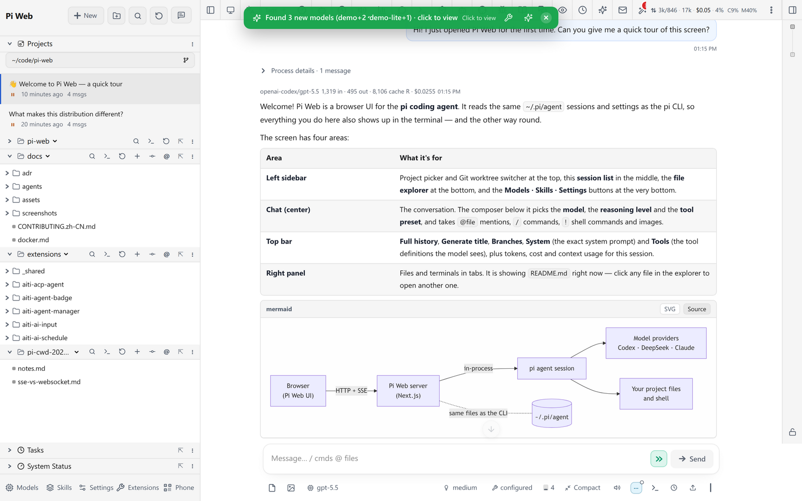

# aiti-demos

> **AITI Web** 的静态演示站——真实的工作台界面 + 真实的扩展宿主，数据来自录制好的 mock 模型。无需服务端、不调模型、不用安装。**在线体验：<https://demo.aiti.pw/>**

[English](./README.md) · 简体中文

官网 <https://aiti.pw> · 演示站 <https://demo.aiti.pw> · 源码 <https://github.com/aiti-ai/aiti-ai>



## 关于 aiti

本项目是 **aiti** 生态的组成部分——以 [pi](https://pi.dev) 为引擎的个人 AI 开发工作台与本地调试注入生态：**aiti-agent**（自托管 Web 工作台，基于开源项目 [pi-web](https://github.com/aiti-ai/aiti-ai) 构建）+ 各开发工具内的调试注入（aiti-devtools）+ 丰富的扩展体系。

- 工作台 / 生态仓库: <https://github.com/aiti-ai/aiti-ai>
- 官网: <https://aiti.pw>
- 本演示站: <https://demo.aiti.pw>

演示里可以直接点开的内容：

- **会话**：15 条教程对话（中英双语），覆盖界面速览、文件与 `@` 引用、模型与推理强度、分支、队列、Worktree、多 Agent 后端、密钥管理与页面调试。
- **扩展**：真实的完整扩展层——目录里 67 个扩展、56 个真实 client bundle 由真实扩展宿主加载（应用中心、停靠面板、设置接管、工具条）。
- **文件**：真实的文件树，Monaco 编辑、`⇋ HEAD` 差异对比、Markdown 预览、Git 变更状态。
- **设置**：模型向导、模型健康检查、MCP、服务商、配额、扩展管理器。
- **其他**：服务端口、分享方式、新模型发现、系统状态、访问统计。

## 哪些是真的，哪些是 mock

| 层 | 本演示站 |
|---|---|
| 工作台界面（`app/`、`components/`、`hooks/`、`lib/`） | **真** —— 从 aiti-ai 源仓同步 |
| 扩展宿主、插槽、client loader、服务 | **真** |
| 扩展 client bundle（56 个） | **真** —— 逐个从各包 `dist/` 原样复制 |
| `/api/*` 响应 | **mock** —— 从真实实例录制、脱敏后在浏览器内回放 |
| Agent 回合、模型调用、终端、桥 | **不执行** —— 用脚本或录制帧表达 |

扩展的服务端逻辑不在这里运行。需要它的面板显示录制快照或降级；演示里的「能力图谱」会标明哪些是真实交互、哪些只是展示。

## 本地运行

```bash
# 需要同级目录有 aiti-ai 检出（或用 AITI_SRC 指向它）
git clone https://github.com/aiti-ai/aiti-ai ../aiti-ai

npm ci
npm run dev      # 同步前端 + 扩展层 + 文件快照，然后 next dev 于 :30146
npm run build    # 静态导出到 out/
```

维护命令：

```bash
npm run sync                 # 从 ../aiti-ai 同步界面到 generated/（gitignore）
npm run sync:check           # 校验 generated/ 是否落后（CI 用）
npm run extensions           # 从 ../aiti-ai/extensions 重建静态扩展层
npm run audit                # fixture / 密钥审计（路径、token、内网 IP）
npm run tour                 # 对 out/ 跑 Playwright 回归
npm run deploy               # 构建 + rsync 到 /var/www + reload nginx（demo.aiti.pw）
```

## 实现方式

```text
app/                     极薄的 Next.js 静态导出外壳
generated/               从 aiti-ai 同步的界面（gitignore；sync --check 防漂移）
public/api/extensions/   真实扩展 dist + 图标，按宿主自己的资源 URL 提供
mock/                    浏览器内后端
  sessions/              教程会话脚本（双语）
  model/routes.json      录制的响应，按路由回放
  model/routes.en.json   含中文路由的英文覆盖表
  boot-seed.ts           演示用文件夹、重 chunk 预热
  analytics.ts           百度统计 + Counterscale（DEMO_ANALYTICS=off 可关）
capture/                 录制器（Playwright + CDP）与编译脱敏脚本
scripts/                 同步、扩展层、审计、覆盖检查、tour、部署
```

录制器驱动一个**真实且隔离的实例**（独立 agent 目录、项目目录与端口），抓取每个 `/api/*` 响应、SSE 帧和扩展资源；`capture/compile.mjs` 再统一归一化路径与标识、清洗凭据，产出 mock 模型。`capture/raw/` 从不离开本机，只有脱敏后的 fixture 会提交。

## 隐私

- 录制数据在编译期脱敏：操作者路径、内部域名、内网地址、服务商清单、打码 key 片段与余额全部替换为演示值。
- `scripts/audit-fixtures.mjs` 会对残留的路径/token/内网地址直接判失败，并在 CI 中运行。
- 演示完全在浏览器内运行：没有凭据，也不会有对外的 agent 调用。

## 访问统计

与文档站同一套：百度统计（`hm.js`，同一属性）与自托管 Counterscale。构建时加 `DEMO_ANALYTICS=off` 可完全关闭。

## 文档

- 文档站: <https://aiti.pw/>
- 扩展注册表: <https://aiti.pw/extensions.html> · 机器可读 <https://aiti.pw/extensions.json>
- 本演示的内部方案（中文）：策略仓中的 aiti-demos 方案文档

## License

MIT
